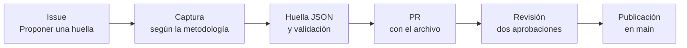

# Cómo proponer y revisar una huella

Esta guía es para el repositorio `huellaip/huellas`: cómo se propone, se arma, se revisa y se publica una huella. Para aportar código, metodología o configuración del laboratorio, la guía está en [`huellaip/huellaip`](https://github.com/huellaip/huellaip/blob/main/CONTRIBUTING.md).

> [!IMPORTANT]
> Las [líneas rojas](https://github.com/huellaip/huellaip/blob/main/CONTRIBUTING.md#líneas-rojas) del proyecto rigen también acá: solo metadatos, solo defensa, contención primero y privacidad por diseño. Un aporte que cruza una se cierra, aunque el resto esté bien.

## Antes de empezar

1. Leé las líneas rojas y el código de conducta del proyecto, ambos en [`huellaip/huellaip`](https://github.com/huellaip/huellaip).
2. Configurá Git para [firmar tus commits con el DCO](https://github.com/huellaip/huellaip/blob/main/CONTRIBUTING.md#firmar-los-commits-dco) (`git commit -s`). En este repo, la firma certifica además que **la captura es tuya o que tenés el consentimiento** de quien la hizo y de los hogares u oficinas involucrados.
3. Revisá que no haya ya una huella, o una propuesta abierta, para el mismo modelo y firmware.

## Cómo se propone una huella



1. **Abrí un issue** con la plantilla *Proponer una huella*. Sirve para avisar qué vas a capturar, evitar trabajo duplicado y recibir comentarios antes de invertir horas de captura.
2. **Capturá** siguiendo la metodología de captura del proyecto. Va a estar en `docs/metodologia-captura.md` de [`huellaip/huellaip`](https://github.com/huellaip/huellaip); mientras tanto, rige la sección 7 del plan del prototipo. En resumen:
   - se mide cada estado de uso por separado: `encendido`, `reposo`, `activo` e `interaccion`;
   - el equipo se usa con la configuración de fábrica y solo con cuentas de laboratorio;
   - el firmware se registra antes y después de cada captura; si cambia, corresponde otra huella;
   - cualquier equipo dudoso, incluido todo TV box genérico, se captura en un segmento de cuarentena con filtros probados.
3. **Armá el JSON** según la [especificación del formato](https://github.com/huellaip/huellaip/blob/main/especificacion/formato-huella-v0.md). Los [ejemplos válidos](https://github.com/huellaip/huellaip/tree/main/especificacion/ejemplos) sirven de punto de partida. Cuando esté el generador de [`huellaip/huellaip`](https://github.com/huellaip/huellaip), se arma con el generador.
4. **Validalo** contra el esquema. El comando se documenta acá cuando el validador esté listo; la validación también va a correr sola en cada PR.
5. **Abrí un PR** con el archivo en la [ruta que corresponde](#dónde-va-el-archivo), completá la plantilla y enlazá el issue.
6. **Respondé la revisión** con commits nuevos y firmados.

## Dónde va el archivo

```text
huellas/<categoria>/<fabricante>/<modelo>/<firmware>.json
```

- Todo en minúsculas, sin tildes ni espacios, con guiones: `fabricante-ejemplo`, no `Fabricante Ejemplo`.
- `<fabricante>` y `<modelo>`: como figuran en la etiqueta o en la información del sistema del equipo. Si el equipo no tiene marca clara, como muchos TV boxes, usá `generico` y el modelo que informa el sistema, y explicá en el PR cómo lo identificaste.
- `<firmware>`: la versión que informa el equipo. Los caracteres que no sean letras, números, puntos o guiones se reemplazan por guiones.
- Una huella por modelo y firmware. Una versión nueva de firmware es un archivo nuevo, no una edición del anterior.

**Categorías iniciales.** Para sumar una, abrí un issue.

| Categoría | Ejemplos |
|---|---|
| `televisor` | Smart TV |
| `streaming` | Stick o dongle de streaming |
| `tv-box` | TV box Android genérico |
| `camara` | Cámara IP |
| `impresora` | Impresora de red |
| `router` | Router de cliente, CPE |
| `asistente` | Parlante inteligente |
| `enchufe` | Enchufe o interruptor inteligente |
| `electrodomestico` | Robot aspiradora y otros electrodomésticos conectados |

## Qué tiene que tener una huella

Según el [formato v0](https://github.com/huellaip/huellaip/blob/main/especificacion/formato-huella-v0.md) (si algo difiere, manda la especificación):

- **Parte MUD:** fabricante (`mfg-name`), modelo (`model-name`), firmware (`firmware-rev`), `mud-url`, fecha de actualización y las listas de acceso con los destinos esperados. Si un destino usa TLS, su regla lleva el perfil TLS del RFC 9761.
- **Extensión `huellaip-perfil:perfil`**, dentro del contenedor MUD:
  - versión del formato, categoría y etiqueta;
  - datos de la captura: país, fechas de inicio y fin, `aportante` y nivel de confianza;
  - métricas de cada estado capturado, con el tamaño de la muestra;
  - los estados no capturados, con el motivo;
  - licencia (`CC-BY-4.0`).

Si falta un estado, la huella lo dice y el PR explica por qué. Por ejemplo, un equipo sin app de control no tiene estado `interaccion`.

### Nivel de confianza

| Nivel | Criterio (propuesta del plan; se fija en la metodología de captura) |
|---|---|
| `baja` | Una sesión por estado, en un solo laboratorio |
| `media` | Las repeticiones mínimas completas y 72 horas de reposo |
| `alta` | Nivel `media` más una réplica en un segundo laboratorio o con datos de un ISP |

### Etiqueta

| Etiqueta | Cuándo se usa | Qué hay que aportar |
|---|---|---|
| `benigno` | No se observó nada que su categoría no haga normalmente | — |
| `sospechoso` | Hay un comportamiento anómalo para su categoría, sin un IOC confirmado | Descripción en el PR, con metadatos agregados |
| `malicioso` | El comportamiento coincide con un indicador de compromiso documentado | Referencia a la fuente del IOC en la huella y en el PR |

La etiqueta describe lo observado en ese modelo con ese firmware. No es un juicio sobre la marca, y el texto de la huella y del PR se limita a los hechos.

## Privacidad

Antes de abrir el PR, revisá que el archivo **no** tenga:

- contenido de las comunicaciones: URLs completas, cuerpos de mensajes, consultas;
- direcciones MAC completas (como mucho, el OUI);
- números de serie, IMEI ni identificadores del equipo;
- cuentas, correos, nombres de usuario ni otros identificadores personales;
- direcciones IP privadas como destinos, ni la IP pública del laboratorio o de quien aporta;
- dominios con un identificador único del equipo o de la cuenta. Algunos servicios usan un subdominio distinto por equipo: reemplazá esa etiqueta por un comodín (`*.dispositivos.fabricante.com`). El comodín va solo en los destinos de la extensión, no en las listas de acceso.

Nunca se suben capturas, logs crudos, binarios ni APKs, ni siquiera como adjuntos de un issue o un PR.

**Datos de ISPs y pilotos.** Solo se aceptan métricas agregadas de muchos equipos del mismo modelo, nunca de un abonado o un hogar identificable, y siempre con el consentimiento explícito que exija el piloto, conforme a la Ley 25.326 de Protección de Datos Personales.

Si subiste algo que no debías, seguí [estos pasos](https://github.com/huellaip/huellaip/blob/main/CONTRIBUTING.md#si-subiste-algo-que-no-debías) y avisá a [huellaip@googlegroups.com](mailto:huellaip@googlegroups.com).

## Revisión

**Quién aprueba.** Cada huella necesita dos aprobaciones, y una tiene que ser de alguien del comité técnico. Quien revisa no puede pertenecer a la organización que aporta la huella ni a una que fabrique o venda ese dispositivo ([GOVERNANCE](https://github.com/huellaip/huellaip/blob/main/GOVERNANCE.md#neutralidad-y-conflictos-de-interés)). Cualquiera puede comentar.

**Qué mira quien revisa:**

- [ ] El archivo valida contra el esquema de la versión del formato que declara.
- [ ] La ruta coincide con los metadatos: categoría, fabricante, modelo y firmware.
- [ ] El firmware no cambió durante la captura.
- [ ] El nivel de confianza corresponde a lo que se capturó (repeticiones, horas de reposo, réplicas).
- [ ] Los números son consistentes: p50 ≤ p95 ≤ máximo, no hay valores negativos y las unidades son las de la especificación.
- [ ] Los estados son coherentes entre sí. Si un estado tiene destinos o volúmenes que no encajan con su definición, el PR lo explica.
- [ ] Los destinos son plausibles para el dispositivo: dominios y ASN del fabricante o de los servicios que usa.
- [ ] La etiqueta está respaldada: `sospechoso` con su descripción; `malicioso` con la fuente del IOC.
- [ ] Pasa el chequeo de [privacidad](#privacidad).
- [ ] La atribución es correcta.
- [ ] Quien revisa no tiene conflicto de interés.

**Veredicto:** aprobar o pedir cambios, con la lista de problemas y el campo afectado por cada uno.

## Actualizar o retirar una huella

- **Firmware nuevo:** archivo nuevo, como cualquier propuesta.
- **Corrección de una huella publicada:** PR sobre el mismo archivo, que explique qué cambia y por qué. Pasa la misma revisión.
- **Recaptura con más datos**, por ejemplo para subir el nivel de confianza: PR sobre el mismo archivo, que actualice la fecha y el nivel.
- **Retiro**, por error grave o por un dato sensible: avisá a [huellaip@googlegroups.com](mailto:huellaip@googlegroups.com) si es sensible, o abrí un issue si no lo es.

## Reconocimiento

Quien aporta figura en la huella y en el historial de Git. Toda persona que use la huella tiene que atribuirla, como pide la licencia [CC-BY-4.0](LICENSE).

¿Dudas? Abrí un issue o preguntá en [`huellaip/huellaip`](https://github.com/huellaip/huellaip). Ninguna pregunta es demasiado básica.
